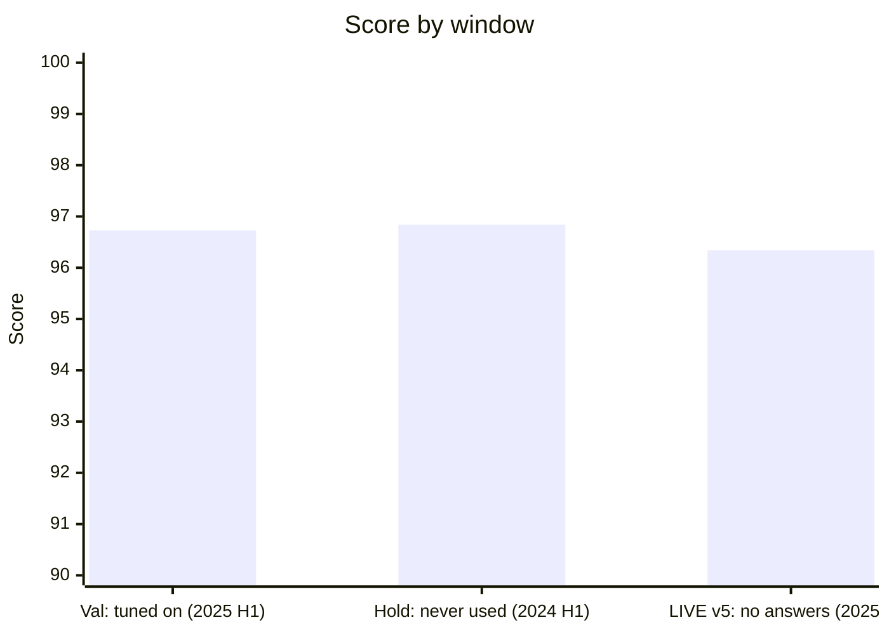
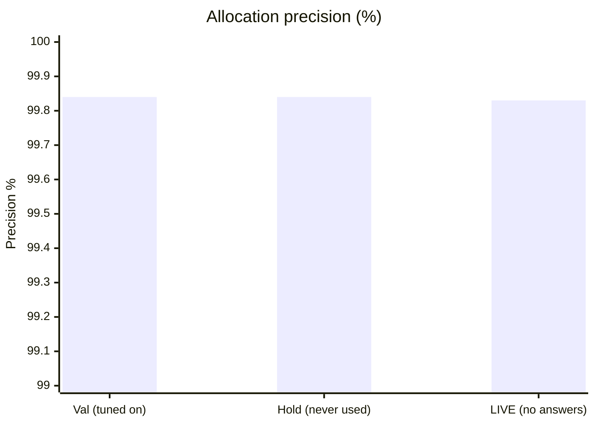
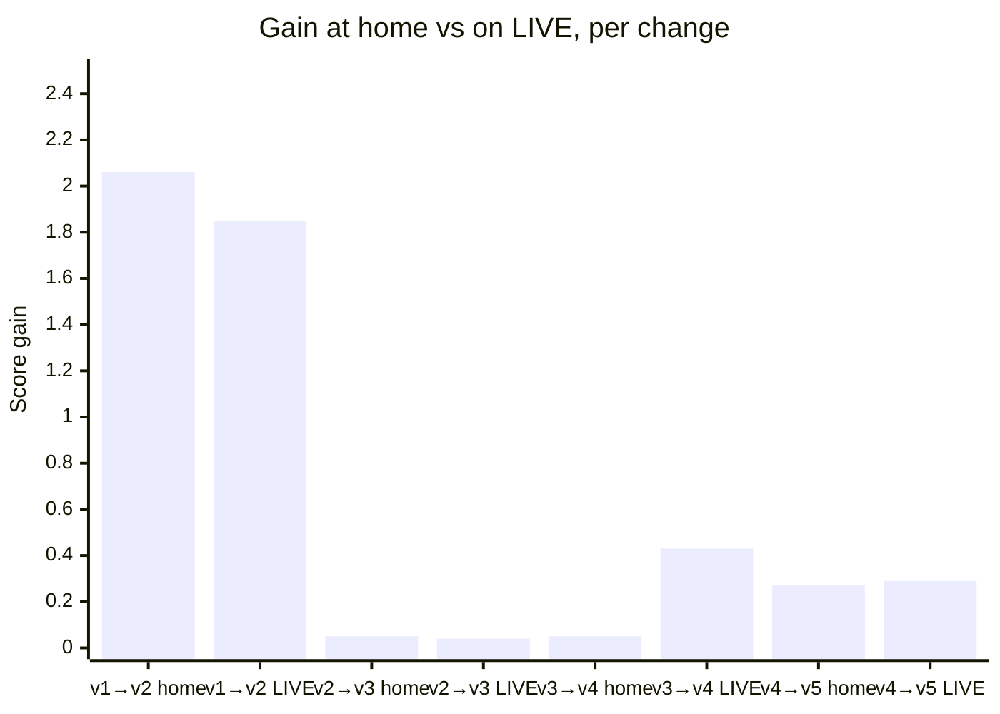

# Overfitting checks: is our reconciliation pipeline overfit?

Generated on 7 Nov 2026 from the existing outputs of branch `kenny/full-pipeline`. Matching and ingestion were not
re-run. Every number below is in `integration/out/overfit_metrics.json`: a flat dictionary of dotted keys, described
in its `_meta.*` keys.

**Short answer: no sign of overfitting to the tuning window.**
- The untouched holdout scores 0.10 *higher* than the window we tuned on.
- Matcher precision is the same in both windows to within 0.013 percentage points.
- The two hand-set thresholds sit on wide, flat plateaus whose optimum is the same in both windows.
- **LIVE v2, built from the same code, scored 95.58: 0.78 below val.** Precision held (0.9983 vs 0.9986), and 90 % of
  the val gain from v1 to v2 also showed up on LIVE.

The 0.78 lost on LIVE is **drift, not overfit rules**: it is concentrated in a few segments where hold equals val.
The remaining risks are all time drift:
1. The learned payer aliases get stale. FINAL will use aliases 6–12 months old, which are wrong about 2 pp more often
   than on val.
2. A new South African company (ZA01) has no history at all.
3. Scores fall over the six months of a window as unmatched lines pile up.
4. A few LIVE segments lose accuracy against val: `ar_1toN_remittance`, `ap_confirming` and `ar_short_dispute`.

**Rule of thumb for FINAL:** take LIVE's 0.8-point gap plus extra staleness, and expect roughly **94.5–95.5**.

**Windows:**
- `val`: TRAIN Jan–Jun 2025. Rules and thresholds were tuned while looking at its answers.
- `hold`: TRAIN Jan–Jun 2024. Never used for tuning. Learned parts are cut at 2024-01-01.
- `LIVE`: Jul–Dec 2025, no answers. Two leaderboard scores: v1 (older code) 93.73, and v2 (the current code, the same
  as val and hold) 95.58.

## Verdict table

| # | Check | Value | Worry if | Verdict |
|---|---|---|---|---|
| 1 | Total score, val − hold | **−0.10** (96.36 vs 96.46). Month-to-month noise gives a standard error of 0.36, so z = −0.3 | val − hold > +0.7 (2 standard errors) | OK |
| 2 | Score parts, val − hold | allocation F1 −0.003 · precision 0.000 · recall −0.005 · transaction accuracy −0.001 · exception F1 +0.003 | any part worse on hold by > 0.01 (> 0.02 for exception F1) | OK |
| 3 | Segments where val beats hold | 1 of 66 at z > 2 (`ar_1to1`, +0.04 pp). About 1.5 expected by chance | > 4, or a segment worth > 1 point with a gap > 2 pp | OK |
| 4 | Small segments with large gaps | `ar_short_bank_charges` +7.7 pp (169 vs 125 lines, z = 2.0); `ap_duplicate_payment` +10.6 pp (66 vs 54 lines) | z > 2 on a rule written from a handful of golden examples | **Watch** |
| 5 | Matcher precision, hold vs val | lines fully right among claimed lines: 99.645 % vs 99.632 %. 1 of 51 methods at z > 2 (`dd_batches_transfer` 99.6 → 98.6 %) | a method with ≥ 500 lines losing > 1 pp on hold | OK |
| 6 | Matcher ablation, val ÷ hold | ratio 0.96–1.04 for every matcher worth > 1 point; `short_payments` 1.18 (2.00 vs 1.69 points) | ratio > 1.25 for a matcher worth > 1 point | OK (`short_payments` watch) |
| 7 | Exception F1, val − hold | largest gap among codes with ≥ 300 cases: 0.011, and hold is the better one. SHORT_BANK_CHARGES +0.047 on 125 cases (its monthly SD is 0.04) | gap > 0.03 on a code with ≥ 300 cases, or > 2 monthly SDs | OK (SHORT_BANK_CHARGES watch) |
| 8 | Monthly spikes | monthly score SD 0.70 (val) and 0.55 (hold). Precision between 99.81 % and 99.90 % in every month. The `sample` month (2025-06), used most during development, is val's **worst** month | a month above mean + 2 SD in val only, or monthly precision < 99.7 % | OK |
| 9 | Decline within a window | −0.35 points/month (val) and −0.19 points/month (hold). It comes from recall: the unclaimed share grows from 10.9 % to 12.4 % while matcher precision stays flat | not an overfitting signal, but late FINAL months will score lower | **Watch** |
| 10 | `UNID_P` sensitivity | every value from 0.8 to 0.99 is within 0.1 points of the best, in both windows. Best is 0.97 in both (+0.05 val, +0.04 hold over 0.9) | a peak narrower than ±0.05, or a different optimum on hold | OK |
| 11 | Veto threshold (`CONF_OVERRIDE`) sensitivity | score range 0.05 points over 0.5–1.01, in both windows | range > 0.3 | OK |
| 12 | Category model, in-sample vs out-of-sample | log-loss 0.0119 → 0.0141 (×1.19). Accuracy on no-item lines 99.98 % in both. AUC 0.9994 → 0.9991 | log-loss ×2, or accuracy −0.5 pp | OK |
| 13 | Category model staleness | a model 12–18 months old on val: AUC 0.99917 vs 0.99912 for the fresh one, accuracy 99.99 % vs 99.98 % | −0.5 pp | OK |
| 14 | Payer-alias staleness | right when an alias hits: 99.6 % in-sample, 97.7 % at 0–6 months, 95.8 % at 6–12, 93.6 % at 12–18. AR-line coverage 0.91 → 0.89 → 0.88 → 0.87 | FINAL is 6–12 months out: expect about 2 pp more wrong alias hits than on val | **Watch** (largest risk from a learned part) |
| 15 | LIVE v1 vs local, same code | LIVE 93.73 vs about 94.3 on val for the v1 code (gap about −0.6). Precision 0.9982 vs 0.9986 | LIVE > 1.5 points below val for the same code, or LIVE precision < 0.997 | OK |
| 16 | LIVE v2 (same code as val and hold) | **95.58**, i.e. 0.78 below val. Precision 0.9983 vs 0.9986. Transaction accuracy 0.9734 vs 0.9748. The loss comes from allocation recall (−0.45 points) and exception F1 (−0.29 points) | LIVE v2 < 94.9 (val − 1.5), or precision < 0.997 | OK |
| 22 | LIVE v2 segments where val beats LIVE | 10 of 60 at z > 2 (about 1.4 expected by chance; hold shows 1 of 66). Together they are worth about 0.1 points. The biggest are `ar_1toN_remittance` (98.3 % vs 100 %) and `ap_confirming` (95.2 % vs 98.4 %), both unchanged from v1 | > 4 | **Watch** (LIVE-specific drift, not overfitting: hold equals val on these) |
| 23 | Did the v1 → v2 gain on val show up on LIVE? | LIVE gained +1.85, against about +2.06 on val for the same code change: **90 %** transferred | < 50 % | OK |
| 17 | LIVE drift: matcher mix | PSI 0.002 (hold vs val: 0.0007). Claimed share 88.2 % vs 88.4 %. `same_amount` +15 %, `subset_sum` −6 % | PSI > 0.1, or claimed share −2 pp | OK |
| 18 | LIVE drift: categories and `p_items` | category PSI 0.008 (hold vs val also 0.008). Share with `p_items` < 0.1: 9.2 % vs 9.1 % | PSI > 0.1 | OK |
| 19 | LIVE drift: exception rates | LIVE v2 ÷ val: SHORT_DISCOUNT ×0.85, OVERPAYMENT ×0.85, SHORT_BANK_CHARGES ×0.82, FX_DIFFERENCE ×0.92. Hold ÷ val stays within ±6 % for every code except SHORT_BANK_CHARGES. The LIVE v2 segment scores say these are real base rates, not misses: `ar_overpayment` 99.1 %, `ar_short_discount` 96.2 % (val 96.3 %) | ratio outside 0.85–1.15 when hold is within ±5 % **and** the matching segment loses accuracy on LIVE | OK (was Watch) |
| 20 | New entities, currencies, banks, formats | ZA01 / ZAR / bank UMVC already appear in LIVE: 2 lines, 0 claimed. Moncayo after its camt.053 switch: claimed 81.5–85.9 %, vs 79.5–83.3 % on N43 | on FINAL: ZA01 claimed share far below the 88 % average | **Watch on FINAL** |
| 21 | Entities and currencies, val − hold | 1 of 17 entities at z > 2 (MX01, +0.8 pp, spread over several segments); 4 entities better on hold. Currencies: 1 vs 1 | > 2 entities better on val | OK |

---

## How to read the numbers

- **Line accuracy** = share of bank lines whose rows are all right, the same rule as the official transaction
  accuracy. **Precision of a matcher** = line accuracy over the lines that matcher claimed.
- **z**: a two-proportion z-score for "val accuracy − hold accuracy". |z| > 2 happens by chance for about 1 group in
  22, so with 66 segments we expect about 1.5 such segments on each side even with no overfitting.
  Count them before panicking (checks 3, 5, 21).
- **Why hold is the right test.** Every rule and threshold was written while looking at val answers. If a rule only
  memorises val quirks (a customer's habits, a coincidence in amounts), it keeps working on val and fails on hold.
  Overfitting therefore shows up as **val > hold**. It hits **precision first**, because overfit rules make
  confident wrong claims; they do not just miss.
- **What hold cannot test.** Both windows are inside TRAIN: same companies, formats and policies. Drift is checked
  separately (checks 14 and 16–20).

---

## 1. Train-vs-holdout gaps

### 1.1 Total score and score parts (checks 1–2)
| | val | hold | val − hold |
|---|---|---|---|
| Score | 96.36 | 96.46 | −0.10 |
| Allocation F1 | 0.9576 | 0.9602 | −0.0026 |
| precision | 0.9986 | 0.9986 | 0.0000 |
| recall | 0.9199 | 0.9247 | −0.0048 |
| Transaction accuracy | 0.9748 | 0.9756 | −0.0008 |
| Exception macro-F1 | 0.9616 | 0.9588 | +0.0028 |

**What it measures:** the headline overfitting gap. **Why it detects overfitting:** an overfit rule set scores
higher where it was tuned. **Threshold:** we take the month-to-month spread of the score (SD 0.70 on val, 0.55 on
hold), turn it into a standard error for a 6-month mean (0.36 for the difference), and worry above 2 standard errors
(+0.7). **Result:** −0.10, so hold is slightly better. The only part that is better on val is exception F1, by 0.003.

### 1.2 Per segment (checks 3–4)
66 segments have at least 30 lines in both windows. Only one is significantly better on val: `ar_1to1` (99.99 % vs
99.96 %, which doesn't matter). One is significantly better on hold: `ap_confirming`. The big point holders are equal
or better on hold:

| Segment | val | hold | gap | z |
|---|---|---|---|---|
| `ar_ref_noise` | 96.07 % | 96.31 % | −0.24 pp | −1.8 |
| `ar_1toN_credit_note` | 74.8 % | 76.6 % | −1.8 pp | |
| `ar_short_dispute` | 82.8 % | 85.6 % | −2.7 pp | −1.7 |
| `ar_n_to_m` | 68.3 % | 67.1 % | +1.2 pp | +0.8 |
| `ar_fx` | 87.4 % | 87.9 % | −0.5 pp | |
| `ar_discount_late` | 84.0 % | 83.4 % | +0.6 pp | |
| **`ar_short_bank_charges`** | 91.7 % | 84.0 % | **+7.7 pp** | +2.0 (169 / 125 lines) |
| **`ap_duplicate_payment`** | 93.9 % | 83.3 % | **+10.6 pp** | +1.8 (66 / 54 lines) |

**Watch:** the two bold rows are both small families whose rules were built from a few dozen golden examples:
- the bank-charge amounts accepted for a short payment;
- the "D"-suffix and implicit-repeat rules for duplicate supplier payments.

Their gaps are near the edge of chance, but this is the pattern overfitting would produce. Together they are worth
about 0.05 points, so the score risk is small. On LIVE v1, `ar_short_bank_charges` was only 35 %, with older code
(section 4).

Accuracy by golden difficulty tier (1/2/3) is identical in both windows: gaps of +0.01, −0.11 and −0.12 pp, all with
|z| < 2. Accuracy by statement format (camt053, MT940, N43) is also identical: gaps within ±0.11 pp.

### 1.3 Per matcher (checks 5–6)
- **Claimed-line precision:** 99.645 % on val vs 99.632 % on hold (176,877 vs 168,627 lines claimed). The lines no
  matcher claims are 80.9 % right on val and 81.4 % on hold.
- **Per method:** 51 methods were tested; only `dd_batches_transfer` is significantly worse on hold (99.58 % → 98.64 %,
  about 950 lines each, z = 2.2). Small methods with visible gaps: `subset_sum:subset_wht` 98.7 % → 94.1 % (75 / 84
  lines) and `short_payments:short_bank_charges` 96.0 % → 92.9 % (125 / 70 lines). `subset_sum:subset_disc` is weak
  in both windows (71.9 % val, 79.1 % hold), so it is a quality issue, not overfitting.
- **Ablation** (hand one matcher family's lines to the classifier instead and re-score; this measures how many
  points the matcher contributes):

| Matcher | val | hold | val ÷ hold |
|---|---|---|---|
| `payment_runs` | 18.54 | 18.29 | 1.01 |
| `remittance_ref` | 13.04 | 12.54 | 1.04 |
| `refs` | 10.83 | 11.23 | 0.96 |
| `subset_sum` | 9.26 | 9.37 | 0.99 |
| `dd_batches` | 6.12 | 6.36 | 0.96 |
| `short_payments` | **2.00** | **1.69** | **1.18** |
| `duplicates` | 1.68 | 1.73 | 0.97 |
| `pdf_cases` | 1.62 | 1.68 | 0.96 |
| `same_amount` | 1.36 | 1.41 | 0.96 |
| `cards_cheques_card` | 1.00 | 1.03 | 0.97 |

**Why it detects overfitting:** a matcher fitted to val contributes more on val than on hold. Only `short_payments`
leans toward val. It is the matcher built most directly on fingerprints taken from the answer key: the overpayment
pattern of a round amount or +1 % / +10 %, and the bank-charge amounts. Part of its gap is simply fewer cases in
hold: 171 vs 125 golden SHORT_BANK_CHARGES. **Threshold:** a ratio above 1.25 for a matcher worth more than 1 point.

### 1.4 Per exception code (check 7)
| Code | golden (val / hold) | F1 val | F1 hold | gap | monthly F1 SD (val / hold) |
|---|---|---|---|---|---|
| PARTIAL | 12,511 / 12,056 | 0.963 | 0.966 | −0.003 | 0.006 / 0.006 |
| OVERPAYMENT | 400 / 399 | 0.992 | 0.997 | −0.005 | 0.007 / 0.005 |
| SHORT_DISCOUNT | 15,624 / 15,310 | 0.982 | 0.987 | −0.005 | 0.006 / 0.004 |
| **SHORT_BANK_CHARGES** | 171 / 125 | 0.937 | 0.890 | **+0.047** | 0.036 / 0.042 |
| SHORT_WITHHOLDING | 4,330 / 4,279 | 0.983 | 0.976 | +0.007 | 0.011 / 0.010 |
| SHORT_DISPUTE | 3,036 / 2,579 | 0.918 | 0.929 | −0.011 | 0.010 / 0.021 |
| DUPLICATE_PAYMENT | 707 / 645 | 0.966 | 0.967 | −0.001 | 0.047 / 0.031 |
| UNIDENTIFIED | 4,585 / 4,499 | 0.956 | 0.962 | −0.006 | 0.002 / 0.003 |
| RETURNED | 4,092 / 3,841 | 0.994 | 0.994 | 0.000 | 0.005 / 0.004 |
| FX_DIFFERENCE | 15,793 / 14,795 | 0.924 | 0.918 | +0.006 | 0.022 / 0.047 |

Several exception rules copy statistical patterns of the golden rather than the written policy:
- the overpayment fingerprint;
- silent discounts accepted up to about 14 days late;
- "one invoice cleared, the other takes the remainder" on two-invoice short payments;
- withholding chosen over retention for MX, BR and MA customers.

Each of those transfers to hold: OVERPAYMENT, SHORT_DISCOUNT, PARTIAL and DUPLICATE_PAYMENT are all equal or better
on hold. Only SHORT_BANK_CHARGES lost 0.047, which is just over one monthly SD on 125 cases: **watch**, not alarm.
Each code is worth 2 points, so the gap costs about 0.09 points.

---

## 2. Time stability within a window (checks 8–9)

| Month | val score | val precision | val recall | hold month | hold score | hold precision | hold recall |
|---|---|---|---|---|---|---|---|
| 1 | 97.01 | 0.9989 | 0.939 | 2024-01 | 96.66 | 0.9986 | 0.926 |
| 2 | 97.05 | 0.9988 | 0.940 | 2024-02 | 96.90 | 0.9986 | 0.940 |
| 3 | 96.76 | 0.9984 | 0.932 | 2024-03 | 97.30 | 0.9990 | 0.948 |
| 4 | 96.50 | 0.9985 | 0.923 | 2024-04 | 96.12 | 0.9988 | 0.912 |
| 5 | 96.01 | 0.9989 | 0.908 | 2024-05 | 95.82 | 0.9981 | 0.912 |
| 6 (`sample`) | 95.24 | 0.9984 | 0.891 | 2024-06 | 96.22 | 0.9983 | 0.920 |

**What it measures:** a rule tuned on one month shows up as a spike in that month. **Result:**
- No month stands out. Precision is flat between 99.81 % and 99.90 %.
- The month used most during development, `sample` = 2025-06, is val's **worst**, the opposite of overfitting to it.

**Watch: window-age decline.** Both windows lose score toward the end: −0.35 points/month on val and −0.19 on hold.
- **It is recall, not precision.** Per-matcher precision is flat across months. What changes is coverage: the share
  of lines left to the classifier grows from 10.9 % to 12.4 % on val, and accuracy on those lines falls from 85 % to
  75 %.
- **Which segments:** the extra misses are mostly in `ar_ref_noise`, `ar_1toN_credit_note` and `ar_1toN_text`. More
  open invoices pile up during the window, so more subsets add up to the same amount and the "unique solution only"
  guards refuse more often.
- **What it means for FINAL:** FINAL is also a 6-month window starting from an official open-items list, so expect
  its late months to score below its early ones.
- **LIVE has no clear trend yet.** The claimed share by month is 88.7, 88.3, 87.6, 87.8, 88.7 and 88.0 %.

---

## 3. Sensitivity of hand-set thresholds (checks 10–11)

### 3.1 `UNID_P` (flag an unclaimed receipt UNIDENTIFIED only when `p_items` < UNID_P)
The sweep is exact: it is re-derived from `line_labels.parquet`, and at 0.9 it reproduces the submitted file row for
row.

| UNID_P | 0.3 | 0.5 | 0.7 | 0.8 | 0.85 | **0.9** | 0.93 | 0.95 | 0.97 | 0.99 | 0.999 | none (1.01) |
|---|---|---|---|---|---|---|---|---|---|---|---|---|
| val score | 96.21 | 96.25 | 96.29 | 96.32 | 96.33 | **96.36** | 96.38 | 96.40 | 96.41 | 96.41 | 96.30 | 96.07 |
| hold score | 96.30 | 96.34 | 96.38 | 96.41 | 96.43 | **96.46** | 96.48 | 96.49 | 96.50 | 96.50 | 96.40 | 96.15 |
| val UNIDENTIFIED F1 | 0.911 | 0.925 | 0.935 | 0.944 | 0.949 | **0.956** | 0.961 | 0.967 | 0.971 | 0.964 | 0.903 | 0.788 |

**Why it detects overfitting:** a threshold tuned to noise sits on a sharp peak that moves between windows. **Result:**
- The curve is a broad plateau. Everything from 0.8 to 0.99 is within 0.1 points of the best, and the curves of the
  two windows have the same shape and the same optimum (0.97).
- 0.9 gives up 0.05 points on val and 0.04 on hold. Moving to 0.95–0.97 would gain those 0.04–0.05 points
  consistently in both windows.
- The risk of moving is a LIVE/FINAL `p_items` distribution that differs. On LIVE it doesn't so far: the share with
  `p_items` < 0.1 is 9.2 % vs 9.1 % on val.

### 3.2 Veto threshold (`CONF_OVERRIDE`, drop a matcher claim when the classifier is this sure the line settles nothing)
This sweep is an exact re-merge with `integration/run.py`'s `merge()`, written to scratch only.

| CONF_OVERRIDE | 0.5 | 0.7 | 0.8 | **0.9** | 0.95 | 0.99 | no veto |
|---|---|---|---|---|---|---|---|
| val | 96.31 | 96.34 | 96.35 | **96.36** | 96.36 | 96.36 | 96.36 |
| hold | 96.41 | 96.45 | 96.45 | **96.46** | 96.46 | 96.46 | 96.43 |

The range is 0.05 points in both windows: the veto barely matters. Note that `P_MIN = 0.2` never binds. A confidence
≥ 0.9 already implies `p_items` ≤ 0.1, so `CONF_OVERRIDE` is the real knob.

### 3.3 Thresholds we could not sweep cheaply
These sit inside `matching/run.py`, which we did not re-run:
- the subset-sum coincidence guard (0.3);
- the duplicate window (0–14 days);
- the MD06 return window (14–80 days);
- the silent-discount window (about 14 days);
- the late-discount band (4–10 days).

Their indirect check is the per-method and per-exception hold results above, which show no gap except the
bank-charge and duplicate-supplier families. A full sweep would need one `matching/run.py` run per value, about
10 minutes each.

---

## 4. Learned components (checks 12–14)

### 4.1 Category model (logistic regression, 22 classes)
| Model cutoff → window | Position | No-item category accuracy | ITEM AUC | Log-loss | UNIDENTIFIED recall at p < 0.9 |
|---|---|---|---|---|---|
| 2025-01-01 → 2024 H2 | in-sample (training data) | 99.984 % | 0.99944 | 0.0119 | 0.943 |
| 2025-01-01 → 2025 H1 (val) | 0–6 months after | 99.984 % | 0.99912 | 0.0141 | 0.923 |
| 2024-01-01 → 2023 H2 | in-sample | 100.000 % | 0.99957 | 0.0109 | 0.951 |
| 2024-01-01 → 2024 H1 (hold) | 0–6 months after | 99.994 % | 0.99928 | 0.0131 | 0.935 |
| 2024-01-01 → 2025 H1 | **12–18 months after** | 99.990 % | 0.99917 | 0.0137 | 0.927 |

**Train vs test:** log-loss rises by a factor of 1.19 out of sample, and category accuracy does not move. That is a
normal, small generalisation gap. ITEM lines are subsampled in training (300k), so "in-sample" is partly in-sample.
**Staleness:** a model 12–18 months old does as well as a fresh one. FINAL's model (trained on all of TRAIN, used
6–12 months later) is therefore not a concern.

### 4.2 Learned payer aliases (bank name or IBAN → customer)
| Alias cutoff → window | Position | Receipts with an alias hit | AR lines with an alias hit | Right when it hits |
|---|---|---|---|---|
| 2024-01-01 → 2023 H2 | in-sample | 83.4 % | 91.2 % | 99.5 % |
| 2025-01-01 → 2024 H2 | in-sample | 82.9 % | 90.5 % | 99.6 % |
| 2024-01-01 → 2024 H1 (hold) | 0–6 months | 82.2 % | 89.8 % | 97.6 % |
| 2025-01-01 → 2025 H1 (val) | 0–6 months | 81.7 % | 89.1 % | 97.7 % |
| 2024-01-01 → 2024 H2 | **6–12 months** | 80.9 % | 88.4 % | **95.8 %** |
| 2024-01-01 → 2025 H1 | **12–18 months** | 79.7 % | 86.9 % | **93.6 %** |
| all TRAIN → LIVE | 0–6 months | 81.4 % | (no answers) | (unknown) |

**This is the clearest train/test gap in the pipeline.** Aliases are memorised name and IBAN strings: 99.6 % right on
the period they were learned from, 97.7 % one window later, and 2 pp worse for every further half-year. Customers
rename themselves and change banks, and POLICIES §6 says more of that happens in 2026.
- **Why it matters for FINAL:** FINAL's aliases come from TRAIN only (LIVE has no answers to learn from), so they
  will be 6–12 months stale. Expect about 95.8 % right-when-hit, against the 97.7 % our val numbers assume.
- **How much of that reaches the score:** only partly. `subset_sum` still needs a unique set of invoices that adds up
  exactly, and it kept 99.5 % precision on both val and hold. Coverage loss (fewer payers resolved) turns into
  recall loss. Wrong hits mostly fail the amount check.
- **Mitigation (untested):** learn extra aliases from our own high-precision LIVE claims, such as `refs:exact` and
  remittance matches at about 100 %, before running FINAL.

LIVE coverage (81.4 % of receipts) is equal to val's (81.7 %), so LIVE shows no extra alias drift yet.

---

## 5. LIVE vs local (checks 15–16)

### 5.1 Which local number to compare LIVE v1 with
`submission_v1.csv.gz` was built at 12:05 from older code (see `integration/out/live_run.log`). That code had no
`short_payments` matcher and an older `subset_sum` without cancelled-item handling, and it predates the half-up
rounding fixes. `insights.md` §6 puts that code at about **94.3** on val, not 96.36.

| | val (current code) | val (v1-era code, about) | LIVE v1 |
|---|---|---|---|
| Score | 96.36 | ~94.3 | **93.73** |
| Allocation precision | 0.9986 | (not logged) | 0.9982 |
| Allocation recall | 0.9199 | (not logged) | 0.8959 |
| Transaction accuracy | 0.9748 | (not logged) | 0.964 |
| Exception macro-F1 | 0.9616 | (not logged) | 0.8801 |

- **Gap for the same code:** about −0.6 (the val-equivalent is uncertain by ±0.5). An earlier teammate measurement
  had LIVE 0.3 *above* val.
- **Precision held on LIVE** (0.9982 vs 0.9986). That is the overfitting-sensitive number, and it is fine.
- **The loss is recall and exceptions,** which fits code age and drift rather than overfit rules.
- **Threshold:** worry if LIVE falls more than 1.5 points below val for the same code, or LIVE precision drops below
  0.997.

### 5.2 LIVE v2: the same code as val and hold
LIVE v2 (`integration/out/live/submission.csv.gz`, built 12:41) is the file that scored **95.58**.

| | val | hold | LIVE v2 | val − LIVE v2 | points lost |
|---|---|---|---|---|---|
| Score | 96.36 | 96.46 | **95.58** | **0.78** | |
| Allocation F1 | 0.9576 | 0.9602 | 0.9487 | 0.0089 | 0.45 |
| precision | 0.9986 | 0.9986 | 0.9983 | 0.0003 | |
| recall | 0.9199 | 0.9247 | 0.9038 | 0.0161 | |
| Transaction accuracy | 0.9748 | 0.9756 | 0.9734 | 0.0014 | 0.04 |
| Exception macro-F1 | 0.9616 | 0.9588 | 0.9470 | 0.0146 | 0.29 |
| Amount-weighted accuracy (not scored) | 0.936 | 0.939 | 0.963 | −0.028 | |

**What this says:**
- **The rules are not overfit.** Precision on LIVE is within 0.0003 of val, and the rules that produce wrong claims
  would be the ones to lose it first.
- **The gain transferred.** The v1 → v2 code change was worth about +2.06 on val and +1.85 on LIVE (90 %).
- **The loss is in recall on pair-heavy lines, and in exceptions.** Line accuracy is almost identical (−0.14 pp). So
  the lines we miss on LIVE are few but carry many invoice pairs (remittance advices, disputed short payments).
- **The 0.78 gap is below the 1.5 alarm.** It also fits what the LIVE segment scores show: drift on a few
  side-file-driven segments.

LIVE v2 changes **2,387 lines** relative to v1 (1.2 % of LIVE): subset_sum 1,797, refs 271, short_payments 152,
cls 80, same_amount 69, other 18.

### 5.3 Per segment: LIVE v1, LIVE v2, val and hold
The dashboard session supplied LIVE per-segment line accuracy. LIVE line counts are not given, so z uses val's counts.
"Points lost" combines the transaction-accuracy points and the allocation-pair points the segment would lose relative
to val, assuming a wrong line loses all its pairs. Together the segments explain about 0.38 of the 0.78 points.

| Segment | val | hold | LIVE v1 | LIVE v2 | z (val vs LIVE v2) | points lost | Reading |
|---|---|---|---|---|---|---|---|
| `ar_short_dispute` | 82.8 % | 85.6 % | 80.8 % | 80.8 % | 1.3 | 0.15 | Within noise per line, but each line holds about 98 pairs. LIVE's new "Voucher" advice layout has no reason column |
| **`ar_1toN_remittance`** | 100 % | 100 % | 98.3 % | 98.3 % | **13.2** | 0.07 | **LIVE-only failure**: about 2 % of advice-paid lines are missed. Likely the Voucher layout (last 6 digits of the invoice number only). **Worth a look before FINAL** |
| `ar_1toN_credit_note` | 74.8 % | 76.6 % | 71.8 % | 73.3 % | 1.4 | 0.04 | noise |
| `ar_fx` | 87.4 % | 87.9 % | 49.3 % | 84.5 % | 1.7 | 0.03 | the v2 FX rework transferred (+35 pp) |
| `ar_ref_noise` | 96.1 % | 96.3 % | 94.8 % | 95.9 % | 1.3 | 0.02 | matches val |
| **`ap_confirming`** | 98.4 % | 99.6 % | 95.2 % | 95.2 % | **4.9** | 0.02 | **LIVE-only**: confirming payment runs |
| `ar_n_to_m` | 68.3 % | 67.1 % | 54.5 % | 65.7 % | 1.7 | 0.02 | noise |
| `ar_1toN_text` | 94.8 % | 95.0 % | 94.1 % | 94.3 % | 1.1 | 0.02 | noise |
| `ar_discount_late` | 84.0 % | 83.4 % | 74.8 % | 82.0 % | 1.1 | 0.01 | v2 fixed it (it was −9 pp in v1) |
| `ar_short_withholding` | 98.1 % | 97.6 % | 93.5 % | 96.9 % | 2.3 | 0.01 | small |
| `ar_short_bank_charges` | 91.7 % | 84.0 % | 35.4 % | 88.4 % | 1.1 | < 0.01 | between val and hold: the small-sample rule transferred |
| `ar_overpayment` | 98.75 % | 99.7 % | 79.8 % | 99.1 % | | | the fingerprint rule transferred |
| `ap_duplicate_payment` | 93.9 % | 83.3 % | 81.4 % | 81.4 % | 3.0 | < 0.01 | like hold, not val: the val number was flattering (check 4) |

**Count of differences:** 10 of 60 segments are significantly better on val than on LIVE v2, and 1 is better on LIVE.
- **Why it isn't overfitting:** in val vs hold the count is 1 of 66, so this is a real but small LIVE shift. On almost
  all of those segments hold equals val, so it doesn't come from rules tuned to val.
- **The other eight:** `ap_duplicate_payment`, `ar_credit_note_paid_out`, `ar_dd_returned`, `ar_dispute_settlement`,
  `ar_instalment`, `ar_new_iban`, `ar_short_withholding`, `nonitem_intercompany`. Each is below 0.01 points.
- **Threshold:** for one segment, a gap above 3 pp with z > 2 that hold doesn't show. Only `ap_confirming` (3.2 pp)
  meets it, and it is worth 0.02 points. `ap_duplicate_payment`'s 12.5 pp gap also appears on hold, so it is a
  flattering val number rather than LIVE drift.

---

## 6. Drift indicators to compute on FINAL (checks 17–20)

These checks need no answers, so they can run on FINAL at 18:00. Here are the LIVE values against val:

| Indicator | val | hold | LIVE (v2) | Alarm |
|---|---|---|---|---|
| Claimed share (lines a matcher claims) | 88.4 % | 88.7 % | 88.2 % | < 86 % |
| PSI of the matcher-family mix vs val | — | 0.0007 | 0.0020 | > 0.1 (moderate), > 0.25 (major) |
| PSI of categories on unclaimed lines vs val | — | 0.0077 | 0.0077 | > 0.1 |
| `p_items` < 0.1 share | 9.08 % | 8.93 % | 9.20 % | ±2 pp |
| `p_items` between 0.1 and 0.9 (uncertain) | 1.13 % | 1.20 % | 1.09 % | > 2 % |
| UNIDENTIFIED flagged share | 2.13 % | 2.23 % | 2.19 % | ±0.5 pp |
| Rows per line | 3.50 | 3.48 | 3.49 | ±10 % |
| Item pairs per line (golden val 3.68) | 3.39 | 3.37 | 3.37 | ±5 % |
| Alias coverage of receipts | 81.7 % | 82.2 % | 81.4 % | < 78 % |

**Matcher line shares, LIVE ÷ val:**
- `same_amount` ×1.15 and `pdf_cases` ×1.08. More same-amount invoices on LIVE; `same_amount` is our least precise
  matcher at 96.5 % on its FIFO branch.
- `subset_sum` ×0.94, `short_payments` ×0.79 and `duplicates` ×0.92.
- Everything else is within ±3 %.

**Exception labels per line, LIVE v2 ÷ val:**
- **SHORT_DISCOUNT ×0.85 and OVERPAYMENT ×0.85.** Hold ÷ val is ×1.04 and ×1.06. The LIVE v2 segment scores settle
  it: `ar_short_discount` is 96.2 % (val 96.3 %) and `ar_overpayment` 99.1 %. So LIVE simply has fewer of these cases;
  our rules are not missing them.
- FX_DIFFERENCE ×0.92 (hold ×0.98).
- SHORT_BANK_CHARGES ×0.82 (hold ×0.71: this code is noisy).
- PARTIAL, RETURNED, UNIDENTIFIED, SHORT_DISPUTE and DUPLICATE_PAYMENT are within ±8 %.

**New elements:**
- **ZA01 / ZAR / bank UMVC already appear in LIVE:** 2 lines on 29–30 Dec 2025 (proforma advances), both classified
  `CUSTOMER_ADVANCE` and unclaimed.
- **Banco del Moncayo after its N43 → camt.053 switch** (Oct 2025): 81.5–85.9 % claimed, against 79.5–83.3 % on LIVE
  N43 and 82–89 % on val. The switch is handled.
- No new statement format. No new entity, currency or bank besides ZA01, ZAR and UMVC.

**On FINAL, check first, in this order:**
1. **Claimed share per entity, especially ZA01.** The other 16 entities range from 67 % (ES00) to 94 %. If ZA01 is
   near 0 %, its invoices (numbered `KWI…`, renamed on 2026-04-01) are not being matched.
2. **Family mix PSI against LIVE.**
3. **Exception rates against LIVE.**
4. **Claimed share by month.** A drop larger than val's 1.5 pp across the window means extra drift.

---

## 7. Other checks that matter

- **Leakage, already checked** (insights §4.1–4.3). The learned parts are time-split per phase, model caches are
  stored per cutoff, and no matcher reads the answer key. The start-state leak cost 0.04 points and is fixed.
- **Multiple comparisons.** With 66 segments, 51 methods, 17 entities and 11 currencies (145 groups), about 3.3 would land
  at |z| > 2 on each side by pure chance. We see 4 on the val side (segments 1, methods 1, entities 1, currencies 1)
  and 6 on the hold side. That is exactly the chance level, with no tilt toward val.
- **Exception F1 is noisy on rare codes.** SHORT_BANK_CHARGES (about 150 cases per half-year) and DUPLICATE_PAYMENT
  vary by 0.03–0.05 F1 from month to month. Each code is worth 2 points, so ±0.1 points of FINAL score is pure noise
  from these two codes alone. Don't read LIVE-vs-local differences below about 0.3 points as signal.
- **Self-consistency of the scorer.** The in-process scorer reproduces 96.36 and 96.46 exactly, and the `UNID_P`
  reconstruction matches the submitted files with 0 mismatched rows.
- **Not computed:** a bootstrap confidence interval on the score (the monthly spread stands in for it), and re-tuning
  matcher-internal thresholds on hold (that needs matching runs).

## How to regenerate

The scratch scripts are copied to the shared notes folder, under `overfit_scripts/`. They read only existing outputs
and write to their own folder:
- `part1.py`: monthly scores and line tables;
- `part2.py`: gaps;
- `part3.py`: `UNID_P` sweep and ablation;
- `part4.py`: category model;
- `part5.py`: aliases;
- `part6.py` then `part6b.py`: LIVE drift (`part6b.py` adds Moncayo, exception rates and ZA01);
- `veto_sweep.py`: veto threshold;
- `assemble.py` then `verdicts.py` then `live_v2.py`: write `integration/out/overfit_metrics.json`, including the
  `verdict.*` keys. `live_v2.py` adds the LIVE v2 leaderboard numbers and the per-segment LIVE gaps (`live_segment.*`)
  from the dashboard's segment files, which are copied next to it.

The drift checks in `part6.py` work for `final` by changing the phase list. Run them with `python3` from that folder.

---

## In plain words: the strongest sign we are not overfitting

> **TL;DR:** the window we never tuned on scores higher than the one we did (96.84 vs 96.73), precision is the same on
> unseen LIVE data (99.83 %), and every local gain showed up on the leaderboard.

**The window we never looked at scores as well as the one we tuned on.** Every rule and threshold was written while
looking at the answers for January–June 2025 (val). We set aside January–June 2024 (hold) and never used it while
building anything; the learned parts only see data from before 2024. If our rules had memorised quirks of the 2025
window, they would score clearly worse on 2024. They don't: with the final code (v5) the untouched window scores
**96.84** against **96.73** on the window we tuned on, slightly *higher*, and the two differ by less than the normal
month-to-month wobble (about 0.36 points). Precision, the share of our matches that are right, is identical in both:
**99.84 %**.

Two things back this up on data nobody has answers for. First, on the LIVE leaderboard (July–December 2025) precision
is still **99.83 %**: when the pipeline makes a match on new data, it is right as often as at home. Second, every change
that helped locally also helped on LIVE, which is what a real improvement does and an overfit tweak does not: the
second-wave matchers gained about +2.06 on val and **+1.85** on LIVE (90 % carried over), the UNIDENTIFIED threshold
+0.05 / **+0.04**, and the `cn_bundles` matcher +0.27 / **+0.29**. The one change that gained much more on LIVE than at
home (the remittance currency fix, +0.05 → **+0.43**) did so because its case never occurs in TRAIN, the opposite of
fitting to it.

**Conclusion.** The rules generalise: an untouched window scores the same, precision holds on unseen data, and local
gains show up on the leaderboard. LIVE is now 0.39 below val (96.34 vs 96.73), and that gap is not overfitting but
drift: it is recall (lines we leave unmatched in the newer data), concentrated in a few segments where the 2024 and 2025
windows agree with each other. That points to FINAL landing near LIVE (roughly 95–96), not to a collapse.

### The evidence in three pictures

**1. Same score on the window we never touched** (higher is better; all three with the final v5 code).

**2. Precision does not move** — the share of submitted matches that are right.

**3. Local gains carry over to the leaderboard** — what we measured at home before uploading vs what LIVE returned.

| Change | Gain on val (at home) | Gain on LIVE (leaderboard) | Carried over |
|---|---|---|---|
| Second-wave matchers (LIVE v1 → v2) | about +2.06 | **+1.85** (93.73 → 95.58) | 90 % |
| UNIDENTIFIED threshold 0.9 → 0.97 (v2 → v3) | +0.05 (hold +0.04) | **+0.04** (95.58 → 95.62) | about 100 % |
| Remittance currency fix + exception refinements (v3 → v4) | +0.05 (hold +0.09) | **+0.43** (95.62 → 96.05) | more than 100 %: the currency case only exists in LIVE |
| `cn_bundles` matcher (v4 → v5) | +0.27 (hold +0.25) | **+0.29** (96.05 → 96.34) | about 100 % |

Sources: `integration/out/val_latest.log`, `integration/out/hold_latest.log` (v5 runs), `overfit_metrics.json`
(`overall.*.precision`, `gap.val_minus_hold.*`, measured on the v3 code), and the LIVE leaderboard responses for v1–v5.
